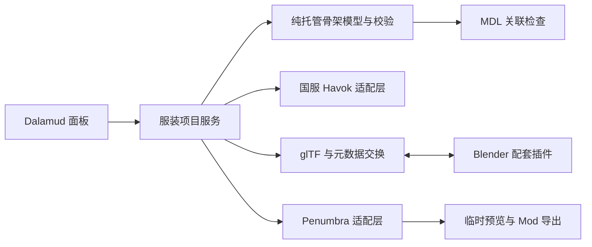

# FFXIV 服装骨骼插件产品与架构

插件应把骨架编辑和服装部署联系起来：选定服装项目，准备正确的附加骨架，送入 Blender，回导后检查骨架与 MDL 的关系，再生成可回滚的 Penumbra 变更。

## 第一版的用户流程

1. 新建服装骨架项目，填写目标上衣、种族与性别，选择当前服装 MDL 和附加 SKLB。允许本地文件、游戏路径或已装 Mod 文件三种来源。
2. 解析该服装实际使用的 EST、基础骨架和附加骨架，显示文件来源与依赖。原版与当前集合解析结果分别展示，由用户选定此次编辑基线。
3. 创建项目目录，保存原始 SKLB、源文件哈希、目标路径和基线快照；导出附加骨架及只读基础骨架参考。
4. 在 Blender 中使用配套插件导入项目。参考骨架明确标记为只读；编辑目标是服装附加骨架。用户添加骨骼和骨骼链，并给服装对应区域分配权重。
5. Blender 插件导出骨架交换结果、元数据和可交给现有模型工具的服装模型。面板提示尚未完成的 MDL 回导步骤。
6. 用户将重新转换出的服装 MDL 交给本插件。插件比较骨架差异，验证骨骼表、权重、映射、EST 和路径计划。
7. 生成候选 SKLB，重新解析候选结果。面板列出新增骨骼、引用变化、阻断项与尚未验证的依赖。
8. 用户在面板点击临时预览，查看实际角色上的服装。确认后导出独立 Penumbra Mod，或提交到明确选择的现有 Mod 选项。
9. 停止预览或卸载插件时移除本项目创建的临时替换。保留项目源文件和已导出的 Mod。

## 第一版支持范围

| 功能 | 范围 |
| --- | --- |
| SKLB 导入 | 已核实包装版本、真实服装附加骨架模板；未知版本只允许只读识别或拒绝 |
| 骨骼编辑 | 保留原骨骼身份和顺序，追加自定义骨骼；新骨骼可挂到有效原骨或新骨 |
| 静止姿态 | 支持新骨骼；既有映射锚点和基础参考锁定；其他原骨变更以后开放 |
| 骨架映射 | 保留并校验模板关系；新增引用规则必须经过单骨样例验证 |
| MDL | 接收用户通过现有工具转换的结果，并检查匹配关系 |
| 预览 | 通过 Penumbra 指定集合进行可撤销替换，明确显示作用范围 |
| 部位 | 先上衣；头部装备作为后续同类扩展 |
| 运动 | 验证新增骨骼随有效父骨运动，允许相关姿态工具支持后的手动摆姿 |
| 物理与动画 | 第一版不生成布料物理、不自动修改 PAP、SKP、PHYB 或其他动态资源 |

“未新增权重的骨骼”可以用于之后制作，面板允许导出 SKLB，但会提示本次服装不会因它而产生蒙皮效果。项目完整预览状态必须根据实际 MDL 再判断。

## 面板布局

面板使用六个步骤页：服装与来源、导出到 Blender、回导、校验、临时预览、安装与回滚。长期保留当前项目、目标种族、装备部位和文件来源摘要。

校验页提供骨骼树和变更表，显示每根骨骼属于原骨、新骨或参考骨。错误条目可定位到骨骼、模型 mesh 或配置路径。用户应能看到“文件结构通过”“服装依赖通过”“国服实测通过”三种不同状态。

预览页显示实际生效路径、EST 变更、集合影响范围和撤销按钮。正式安装前展示具体文件与配置差异，不自动提交文件监听检测到的新结果。

## 模块划分



| 模块 | 职责 |
| --- | --- |
| Skeleton.Core | 骨骼身份、父子图、TRS、差异、索引映射、校验结果；不持有游戏指针 |
| Sklb.Container | 包装版本、偏移、层信息、原始字节保留与受控重写 |
| Havok.Runtime | 基线 HKX 解析、对象图快照、候选重建与保存，封装全部 unsafe 代码 |
| Clothing.Project | 装备、种族、EST、源路径、文件哈希、导入导出状态与版本 |
| Blender.Exchange | glTF 与 sidecar 对照、骨骼身份、只读参考骨架、坐标转换 |
| Clothing.Validation | 骨架、mapper、MDL、目标路径与版本的一致性检查 |
| Penumbra.Adapter | 能力探测、路径解析、临时替换、重绘、正式 Mod 导出与重载 |
| Blender.Addon | 导入项目、身份保护、追加骨骼、编辑检查、一键导出 |

## 运行时和文件边界

Havok 操作串行调度到 Framework 线程。耗时文件读取、哈希计算、JSON 和纯托管图检查可在后台执行。后台任务只能接收托管快照，不能保留游戏对象或 Havok 指针。

取消任务不能在原生保存中途释放资源；适配层应在安全阶段边界观察取消请求。指针所有权、hkResource 生命周期、字符串与数组分配方式、保存返回码和异常处理都集中在运行时模块。普通 try/catch 不构成原生崩溃隔离。

编辑基线是从文件读取的私有对象图。候选重建不修改角色正在使用的运行时 skeleton。保存到独立候选文件后，再由 Penumbra 让游戏重新加载。

原始文件只读。写入采用临时文件与完成标记，校验成功后原子替换项目候选结果。每次候选有独立版本、哈希和报告。重复转换使用独立工作目录，避免固定 temp.hkx 文件互相覆盖。

## 附加骨架的部署方式

对已有 top 附加骨架的上衣，首个样例保留其有效连接结构、ID 和 mapper，追加新骨骼，修改必要的相关引用。对没有附加骨架的目标装备，后续增加“从已验证模板建立附加骨架”，并显式创建对应的 EST 变更。

目标游戏路径由装备与 EST 的实际解析结果确定。下式只表示常见命名结构，不能作为已经存在的资源：

```text
chara/human/c{raceCode}/skeleton/top/t{skeletonId}/skl_c{raceCode}t{skeletonId}.sklb
chara/equipment/e{equipmentSetId}/model/c{raceCode}e{equipmentSetId}_top.mdl
```

实现时区分游戏路径和磁盘路径。磁盘候选 SKLB 通过 File Redirection 映射到游戏路径；Penumbra 的 File Swap 则是游戏路径之间的替换，两者不能在配置中混用。[Penumbra 路径配置](https://github.com/xivdev/Penumbra/wiki/Advanced-Editing#file-redirections)

EST、MDL 和 SKLB 应作为同一部署版本提交。若只更新 SKLB，而目标服装仍使用另一个 skeleton ID 或旧 MDL 权重，面板不得宣称已完成服装安装。

## Penumbra 预览与正式安装

API 适配器先探测运行中的版本和所需功能。当前公开参考具有 `AddTemporaryMod`、`RemoveTemporaryMod`、`CreateTemporaryCollection`、`AssignTemporaryCollection` 等契约，但国服安装版本可能具有其他版本化入口，应以运行时能力为准。[临时 API 源码](https://github.com/Ottermandias/Penumbra.Api/blob/45749c89e80ab9f7a7a0557b9c87770980048051/IpcSubscribers/Temporary.cs)

预览可以应用于指定现有集合，但该集合可能被多个角色共享。需要单角色预览时，先验证临时集合能保留当前服装 Mod 的有效文件和设置，再分配给目标角色；不能假设一个新建空集合会自动继承所有设置。

每个预览记录 tag、collection GUID、priority、文件版本和角色身份。角色 object index 可能被复用，重绘前重新核实目标身份。优先级不能固定用最大整数；应显示与现有 Mod 的冲突和最终解析路径。

为包含 EST 的预览生成当前 Penumbra 版本支持的 metadata manipulations 序列化内容。只放项目需要的条目，不把读取到的整个集合配置作为自己的临时修改重新发布。[Meta API](https://github.com/Ottermandias/Penumbra.Api/blob/45749c89e80ab9f7a7a0557b9c87770980048051/Api/Meta.cs)

正式安装优先输出独立、可检查的 Mod 文件夹。写入现有 Mod 时必须选择具体 group 与 option，保留其他配置，并检查从导出至提交期间文件是否已变化。预览清理完成并重绘成功后，才清理相关候选文件；游戏仍在引用时不能提前删除。
