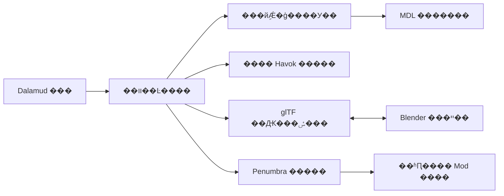

# FFXIV ��װ���������Ʒ��ܹ�

���Ӧ�ѹǼܱ༭�ͷ�װ������ϵ������ѡ����װ��Ŀ��׼����ȷ�ĸ��ӹǼܣ����� Blender���ص�����Ǽ��� MDL �Ĺ�ϵ�������ɿɻع��� Penumbra �����

## ��һ����û�����

1. �½���װ�Ǽ���Ŀ����дĿ�����¡��������Ա�ѡ��ǰ��װ MDL �͸��� SKLB�����������ļ�����Ϸ·������װ Mod �ļ�������Դ��
2. �����÷�װʵ��ʹ�õ� EST�������Ǽܺ͸��ӹǼܣ���ʾ�ļ���Դ��������ԭ���뵱ǰ���Ͻ�������ֱ�չʾ�����û�ѡ���˴α༭���ߡ�
3. ������ĿĿ¼������ԭʼ SKLB��Դ�ļ���ϣ��Ŀ��·���ͻ��߿��գ��������ӹǼܼ�ֻ�������Ǽܲο���
4. �� Blender ��ʹ�����ײ��������Ŀ���ο��Ǽ���ȷ���Ϊֻ�����༭Ŀ���Ƿ�װ���ӹǼܡ��û����ӹ����͹�������������װ��Ӧ�������Ȩ�ء�
5. Blender ��������Ǽܽ��������Ԫ���ݺͿɽ�������ģ�͹��ߵķ�װģ�͡������ʾ��δ��ɵ� MDL �ص����衣
6. �û�������ת�����ķ�װ MDL ���������������ȽϹǼܲ��죬��֤��������Ȩ�ء�ӳ�䡢EST ��·���ƻ���
7. ���ɺ�ѡ SKLB�����½�����ѡ���������г��������������ñ仯�����������δ��֤��������
8. �û����������ʱԤ�����鿴ʵ�ʽ�ɫ�ϵķ�װ��ȷ�Ϻ󵼳����� Penumbra Mod�����ύ����ȷѡ������� Mod ѡ�
9. ֹͣԤ����ж�ز��ʱ�Ƴ�����Ŀ��������ʱ�滻��������ĿԴ�ļ����ѵ����� Mod��

## ��һ��֧�ַ�Χ

| ���� | ��Χ |
| --- | --- |
| SKLB ���� | �Ѻ�ʵ��װ�汾����ʵ��װ���ӹǼ�ģ�壻δ֪�汾ֻ����ֻ��ʶ���ܾ� |
| �����༭ | ����ԭ�������ݺ�˳��׷���Զ���������¹����ɹҵ���Чԭ�ǻ��¹� |
| ��ֹ��̬ | ֧���¹���������ӳ��ê��ͻ����ο�����������ԭ�DZ���Ժ󿪷� |
| �Ǽ�ӳ�� | ������У��ģ���ϵ���������ù�����뾭������������֤ |
| MDL | �����û�ͨ�����й���ת���Ľ���������ƥ���ϵ |
| Ԥ�� | ͨ�� Penumbra ָ�����Ͻ��пɳ����滻����ȷ��ʾ���÷�Χ |
| ��λ | �����£�ͷ��װ����Ϊ����ͬ����չ |
| �˶� | ��֤������������Ч�����˶������������̬����֧�ֺ���ֶ����� |
| �����붯�� | ��һ�治���ɲ������������Զ��޸� PAP��SKP��PHYB ��������̬��Դ |

��δ����Ȩ�صĹ�������������֮������������������� SKLB��������ʾ���η�װ����������������ƤЧ������Ŀ����Ԥ��״̬�������ʵ�� MDL ���жϡ�

## ��岼��

���ʹ����������ҳ����װ����Դ�������� Blender���ص���У�顢��ʱԤ������װ��ع������ڱ�����ǰ��Ŀ��Ŀ�����塢װ����λ���ļ���ԴժҪ��

У��ҳ�ṩ�������ͱ��������ʾÿ����������ԭ�ǡ��¹ǻ�ο��ǡ�������Ŀ�ɶ�λ��������ģ�� mesh ������·�����û�Ӧ�ܿ������ļ��ṹͨ��������װ����ͨ����������ʵ��ͨ�������ֲ�ͬ״̬��

Ԥ��ҳ��ʾʵ����Ч·����EST ���������Ӱ�췶Χ�ͳ�����ť����ʽ��װǰչʾ�����ļ������ò��죬���Զ��ύ�ļ�������⵽���½����

## ģ�黮��



| ģ�� | ְ�� |
| --- | --- |
| Skeleton.Core | �������ݡ�����ͼ��TRS�����졢����ӳ�䡢У��������������Ϸָ�� |
| Sklb.Container | ��װ�汾��ƫ�ơ�����Ϣ��ԭʼ�ֽڱ������ܿ���д |
| Havok.Runtime | ���� HKX ����������ͼ���ա���ѡ�ؽ��뱣�棬��װȫ�� unsafe ���� |
| Clothing.Project | װ�������塢EST��Դ·�����ļ���ϣ�����뵼��״̬��汾 |
| Blender.Exchange | glTF �� sidecar ���ա��������ݡ�ֻ���ο��Ǽܡ�����ת�� |
| Clothing.Validation | �Ǽܡ�mapper��MDL��Ŀ��·����汾��һ���Լ�� |
| Penumbra.Adapter | ����̽�⡢·����������ʱ�滻���ػ桢��ʽ Mod ���������� |
| Blender.Addon | ������Ŀ�����ݱ�����׷�ӹ������༭��顢һ������ |

## ����ʱ���ļ��߽�

Havok �������е��ȵ� Framework �̡߳���ʱ�ļ���ȡ����ϣ���㡢JSON �ʹ��й�ͼ�����ں�ִ̨�С���̨����ֻ�ܽ����йܿ��գ����ܱ�����Ϸ����� Havok ָ�롣

ȡ����������ԭ��������;�ͷ���Դ�������Ӧ�ڰ�ȫ�׶α߽�۲�ȡ������ָ������Ȩ��hkResource �������ڡ��ַ�����������䷽ʽ�����淵������쳣����������������ʱģ�顣��ͨ try/catch ������ԭ���������롣

�༭�����Ǵ��ļ���ȡ��˽�ж���ͼ����ѡ�ؽ����޸Ľ�ɫ����ʹ�õ�����ʱ skeleton�����浽������ѡ�ļ������� Penumbra ����Ϸ���¼��ء�

ԭʼ�ļ�ֻ����д�������ʱ�ļ�����ɱ�ǣ�У��ɹ���ԭ���滻��Ŀ��ѡ�����ÿ�κ�ѡ�ж����汾����ϣ�ͱ��档�ظ�ת��ʹ�ö�������Ŀ¼������̶� temp.hkx �ļ����า�ǡ�

## ���ӹǼܵIJ���ʽ

������ top ���ӹǼܵ����£��׸�������������Ч���ӽṹ��ID �� mapper��׷���¹������޸ı�Ҫ��������á���û�и��ӹǼܵ�Ŀ��װ�����������ӡ�������֤ģ�彨�����ӹǼܡ�������ʽ������Ӧ�� EST �����

Ŀ����Ϸ·����װ���� EST ��ʵ�ʽ������ȷ������ʽֻ��ʾ���������ṹ��������Ϊ�Ѿ����ڵ���Դ��

```text
chara/human/c{raceCode}/skeleton/top/t{skeletonId}/skl_c{raceCode}t{skeletonId}.sklb
chara/equipment/e{equipmentSetId}/model/c{raceCode}e{equipmentSetId}_top.mdl
```

ʵ��ʱ������Ϸ·���ʹ���·�������̺�ѡ SKLB ͨ�� File Redirection ӳ�䵽��Ϸ·����Penumbra �� File Swap ������Ϸ·��֮����滻�����߲����������л��á�[Penumbra ·������](https://github.com/xivdev/Penumbra/wiki/Advanced-Editing#file-redirections)

EST��MDL �� SKLB Ӧ��Ϊͬһ����汾�ύ����ֻ���� SKLB����Ŀ���װ��ʹ����һ�� skeleton ID ��� MDL Ȩ�أ���岻����������ɷ�װ��װ��

## Penumbra Ԥ������ʽ��װ

API ��������̽�������еİ汾�����蹦�ܡ���ǰ�����ο����� `AddTemporaryMod`��`RemoveTemporaryMod`��`CreateTemporaryCollection`��`AssignTemporaryCollection` ����Լ����������װ�汾���ܾ��������汾����ڣ�Ӧ������ʱ����Ϊ׼��[��ʱ API Դ��](https://github.com/Ottermandias/Penumbra.Api/blob/45749c89e80ab9f7a7a0557b9c87770980048051/IpcSubscribers/Temporary.cs)

Ԥ������Ӧ����ָ�����м��ϣ����ü��Ͽ��ܱ������ɫ��������Ҫ����ɫԤ��ʱ������֤��ʱ�����ܱ�����ǰ��װ Mod ����Ч�ļ������ã��ٷ����Ŀ���ɫ�����ܼ���һ���½��ռ��ϻ��Զ��̳��������á�

ÿ��Ԥ����¼ tag��collection GUID��priority���ļ��汾�ͽ�ɫ���ݡ���ɫ object index ���ܱ����ã��ػ�ǰ���º�ʵĿ�����ݡ����ȼ����̶ܹ������������Ӧ��ʾ������ Mod �ij�ͻ�����ս���·����

Ϊ���� EST ��Ԥ�����ɵ�ǰ Penumbra �汾֧�ֵ� metadata manipulations ���л����ݡ�ֻ����Ŀ��Ҫ����Ŀ�����Ѷ�ȡ������������������Ϊ�Լ�����ʱ�޸����·�����[Meta API](https://github.com/Ottermandias/Penumbra.Api/blob/45749c89e80ab9f7a7a0557b9c87770980048051/Api/Meta.cs)

��ʽ��װ��������������ɼ��� Mod �ļ��С�д������ Mod ʱ����ѡ����� group �� option�������������ã������ӵ������ύ�ڼ��ļ��Ƿ��ѱ仯��Ԥ��������ɲ��ػ�ɹ��󣬲�������غ�ѡ�ļ�����Ϸ��������ʱ������ǰɾ����
